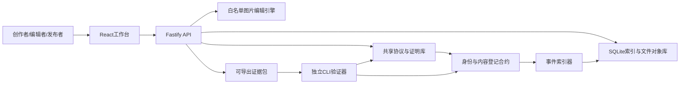

# 内容证链 ContentProof：完整实施规划与代码工作说明书

版本：1.0。编写日期：2026-10-23（北京时间）。项目目录：本文件所在工作区。

实施更新：代码已开始按本规划落地，当前实际功能、文件合并调整、验证记录与后置项见[IMPLEMENTATION_STATUS.md](IMPLEMENTATION_STATUS.md)。下面保留原始计划，不能把计划复选框作为当前实施结果。

本文件是后续开发的执行依据。本轮交付规划，尚未实现下面列出的业务源码；代码清单逐文件规定需要写什么、与谁交互以及如何验收，不把接口设计或示例当成已完成代码。项目是否完成由验收证据决定，不由文件数量决定。

## 1. 最终目标与范围

参赛题名：**内容证链——面向AI内容编辑流程的可验证来源与选择性披露系统**。

作品解决一个可具体演示的问题：素材在创作者、编辑机构和发布机构之间流转，接收者如何在不信任业务服务器的条件下核验文件、签名、编辑关系、披露范围和链上登记状态。

首版限定为图片：PNG、JPEG输入，平台内编辑统一输出PNG。支持导入、裁剪、缩放、旋转、两图合成、AI生成声明、签名、链上锚定、证据包导出及独立验证。视频、音频和任意第三方编辑软件插件列为扩展，不是首轮交付依赖。

完整交付包括：前端、API服务、密码与协议库、编辑引擎、两个智能合约、事件索引器、独立命令行验证器、测试、攻击样本生成器、基线实现、性能实验、Windows运行脚本、可选容器配置和中文参赛材料。

### 1.1 必须明确的能力边界

1. 签名证明某个密钥签署了声明，不能证明画面对应真实事件，也不自动证明版权归属。
2. 原始文件导入及AI生成属性，默认属于签名者声明。没有模型服务方签名或其他外部证据时，不能标成独立确认的生成事实。
3. 只有平台受控执行且拥有输入、操作参数、指定引擎版本的编辑，才能通过独立复算获得“操作已复算”状态。其他编辑只能获得“关系已声明”状态。
4. 隐藏字段的Merkle承诺支持已披露字段的完整性验证，不是零知识证明，不保证所有信息不泄露。
5. 承诺中的父节点总数可以约束导出包的披露数量；不能证明恶意作者没有在最初签署时隐瞒实际使用的素材。
6. 缺少来源证据时返回“来源未知/证据不足”，不能据此判定为伪造。
7. 本地Hardhat链是真实EVM开发链，但由一台机器控制，不声称实现了多机构共识部署。
8. 链上锚定证明相应承诺至迟在某个已确认区块中存在；不证明用户填报的创作时间真实。

### 1.2 用户与主场景

用三个独立测试身份代表创作者A、编辑机构B、发布机构C；另设验证者D。身份是链上注册密钥与组织标签的绑定，初期由演示管理员登记，不宣称真实机构认证。

主场景：A导入图片并签名；B裁剪并与另一素材合成；C只公开最终成品、编辑类型和部分来源信息，隐藏提示词、精确位置、未公开素材；D导入证据包独立验证。随后分别篡改文件、替换父节点、删除证据、改变披露字段，展示不同失败原因。

## 2. 研究贡献、现有工作与退出条件

C2PA已经定义了内容绑定、动作、素材关系、签名和信息删减。不得把DAG、哈希、数字签名、Merkle树或“接入区块链”本身写成新发明。首版采用自定义sidecar协议，不冒充完整C2PA兼容实现。

拟验证的三个贡献候选：

| 编号 | 候选贡献 | 必须提供的证据 | 不成立时的处理 |
|---|---|---|---|
| R1 | 披露感知的证据覆盖模型 | 在隐藏字段、隐藏父节点和缺失证据情况下，给出可重复的状态分类，避免部分验证被错误显示为完全验证 | 若与已有方法无实质差异，改写为工程能力，不宣称学术原创 |
| R2 | 绑定编辑上下文的承诺与验证包 | 证明父节点顺序、操作参数、引擎版本、输出文件和签名主体被同一声明绑定；对替换及删减实验给出结果 | 发现无法验证的转换时降为签名声明 |
| R3 | 服务端之外的独立验证与状态核验 | 关闭业务API后仍能验证证据包；篡改数据库无法绕过链上承诺和签名检查 | RPC离线时明确链上状态未检查，不输出最新可信状态 |

文献检索任务：整理C2PA 2.4、签名溯源、可删减签名、Merkle选择性披露、来源图验证和链上内容存证的差异表。实现前完成第一轮；比赛报告冻结前再检索一次。未检索完不得声称“首次”“首创”或“优于所有方案”。

区块链适用性：跨机构共享登记顺序、密钥状态与承诺，降低对单个业务数据库管理员的依赖。单机构签名日志也能完成许多完整性功能，必须作为基线比较，不能把数据库所有问题都归因于中心化。

## 3. 功能分级与完成定义

### P0：首轮提交必需

- 三身份导入、受控编辑、签名与真实本地链登记。
- 原文件SHA-256摘要及版本化sidecar manifest。
- 字段加盐承诺、Merkle成员证明、父节点槽位及披露数量约束。
- DAG追踪、缺失/隐藏节点区分、文件篡改与签名错误定位。
- 带链上读校验的独立CLI，不依赖业务API。
- 图片编辑真实执行，不用前端动画假装执行成功。
- 上传、编辑、锚定、导出、验证完整UI及异常反馈。
- 核心安全测试、集成测试、端到端流程及原始实验记录。
- Windows启动说明、离线演示准备说明、匿名参赛材料。

### P1：决赛增强

- 三个业务API实例分别持有组织密钥/数据，协作交换证据包。
- 多RPC交叉核验与更明确的信任配置；多节点链部署单独验收。
- 完整实现同一合约调用的批量登记，实测成本收益。
- 解析真实C2PA样本并保留其原生验证结果；适配结果标明映射损失。
- 用户持有密钥签名，服务端不持有用户私钥；演示托管模式有醒目标识。
- 更大规模数据实验、浏览器本地文件摘要、增量图加载。

### P2：条件允许才做

- 视频分段、音频、编辑器插件、签名模型服务回执、外部时间戳。
- 零知识计算证明、水印关联、感知哈希检索仅作为独立研究扩展，不能代替精确文件验证。

任何P1/P2未完成均在报告中列明，不能用占位界面宣称已支持。

## 4. 技术方案与环境

已检查工作区：当前为空，没有现有项目可复用；不是Git仓库，未发现工作区AGENTS.md。已检测Node.js 22.23.1、npm 10.9.8、Python 3.13.9及Docker命令；未验证Docker守护进程可用，未发现ffmpeg。

| 层 | 计划选择 | 原因与约束 |
|---|---|---|
| 工程组织 | npm workspaces + TypeScript ESM | 单锁文件，共享协议，Windows可运行 |
| 前端 | React + Vite + React Router + React Flow | 工作台、图关系、验证报告；具体版本在安装时验证并锁定 |
| 后端 | Fastify + Zod + multipart | 流式上传、边界校验、OpenAPI |
| 持久化 | SQLite + Drizzle + 文件对象存储 | 首版不依赖数据库服务；SQLite驱动需先做Windows安装探针 |
| 图片执行 | sharp，锁定版本及编码参数 | 只支持可重复的白名单操作，记录libvips版本 |
| 协议 | RFC 8785 JCS + SHA-256 + EIP-712 | 固定规范化和签名边界 |
| 链与合约 | Hardhat 3 + Solidity + OpenZeppelin + viem | EVM本地部署、合约测试、类型化签名 |
| 测试 | Vitest + fast-check + Playwright | 固定向量、性质测试、实际浏览器流程 |
| 部署 | 原生Windows脚本优先，可选Docker Compose | 首版不以容器成功为唯一运行方式 |

版本策略：安装时查官方兼容矩阵，做最小安装/编译验证后精确锁定。保留package-lock.json，后续用npm ci。计划中的主版本是选型，不是已验证安装结果。Hardhat 3对Node版本的要求以其官方文档为准，当前环境满足22.13.0起的入门要求。

不引入Redis、Kafka、Kubernetes、独立微服务集群、代币或交易市场。对象存储以接口封装，后续可替换为S3兼容实现，不把IPFS作为可用性前提。



## 5. 协议与数据模型

### 5.1 文件与声明分离

媒体文件保持原字节不变，证据存于独立manifest/证据包。避免“把摘要写进文件后又改变文件摘要”的循环。内嵌C2PA是后续适配，必须遵循其内容绑定规则，不复用sidecar的原文件哈希假冒内嵌绑定。

所有协议数值仅接受安全整数；大整数采用十进制字符串，时间统一UTC ISO字符串。拒绝重复JSON键、NaN、Infinity、孤立代理字符、未知协议版本和超限嵌套。地址解析后规范化，bytes32采用固定长度十六进制。Unicode不额外做NFC变换，按JCS约定编码。

### 5.2 核心对象

```ts
type Hex32 = `0x${string}`; // 运行时仍必须检查32字节
type Address = `0x${string}`;
type Operation = 'import' | 'crop' | 'resize' | 'rotate' | 'compose' | 'ai-declaration';

interface ClaimCore {
  protocol: 'contentproof/1';
  assetDigest: Hex32;          // 原始文件字节SHA-256
  mediaType: 'image/png' | 'image/jpeg';
  byteLength: number;
  claimsRoot: Hex32;           // 可披露字段承诺树
  claimLeafCount: number;
  parentsRoot: Hex32;          // 有序父节点槽位承诺树
  parentCount: number;
  operation: Operation;        // 强制公开
  engineDigest: Hex32;         // 不支持复算的声明使用明确的零值
  issuer: Address;
  keyEpoch: string;
  nonce: string;
  deadline: string;            // Unix秒十进制字符串
}

interface SignedManifest {
  core: ClaimCore;
  signature: `0x${string}`;
  disclosure: DisclosureDocument;
}

interface FieldDisclosure {
  path: string;               // 规范化字段路径，不能重复
  index: number;
  value: unknown;
  salt: Hex32;                // 每次承诺独立随机生成
  siblings: Hex32[];
}

interface ParentSlot {
  index: number;
  visibility: 'disclosed' | 'withheld';
  commitment: Hex32;
  parent?: { claimId: Hex32; assetDigest: Hex32; role: string; salt: Hex32 };
  siblings: Hex32[];
}

interface DisclosureDocument {
  fields: FieldDisclosure[];
  fieldCommitments: Hex32[];  // 按index完整列出，可重建root与计数
  parents: ParentSlot[];      // 必须覆盖全部签署槽位
}
```

操作参数、工具说明、模型名称、提示词、声明时间和授权说明等是claims树中的字段。图遍历依据claimId而不是assetDigest；同一文件允许有不同签名声明，不强行把最早登记者视为作者。

`ClaimCore`的字段、顺序与EIP-712类型定义在共享库和合约中严格一致。`claimId`定义为EIP-712最终签名摘要；不包含signature自身。域固定包含name、version、chainId和verifyingContract，避免跨链/跨合约混用。nonce在合约中显式管理，EIP-712自身不提供重放保护。

### 5.3 哈希和Merkle规则

1. assetDigest = SHA256(fileBytes)，仅描述精确字节，不描述“视觉上相似”。
2. 承诺叶子使用类型前缀和JCS对象：SHA256(0x00 || UTF8(JCS({domain,index,path,value,salt})))。
3. 父节点叶子使用另一domain，绑定槽位index、父claimId、父assetDigest、role和salt。
4. 中间节点 = SHA256(0x01 || left32 || right32)，左右顺序保留，不做无序排序。
5. 字段按唯一path排序并分配index，父节点按编辑输入顺序编号。父节点顺序不能排序，否则合成图层语义会变化。
6. 奇数层复制最后节点。空树有固定、带域分离的空根；空树证明只允许leafCount=0。固定测试向量覆盖0/1/2/3/5个叶子。
7. 证明同时校验index、leafCount、证明长度和每层方向，不能只比较最后root。重复叶子和多余槽位拒绝。
8. 公开完整叶承诺列表及parentCount会暴露字段/父节点数量；隐私报告必须计入这类结构泄露。盐为独立32字节CSPRNG，不重用、不写日志。

### 5.4 DAG验证与证据覆盖

每个父节点引用具体claimId，承诺同时绑定其输出assetDigest。合约仅登记当前声明承诺，不在线遍历整个DAG。验证器执行深度/节点数限制、去重、环检测、父节点承诺验证和跨包引用核对。

覆盖模型不输出模糊的“可信度98%”。结果至少包含：

```ts
interface VerificationReport {
  schemaVersion: 'contentproof-report/1';
  claimId: Hex32;
  checkedAt: string;
  checks: {
    file: 'match' | 'mismatch' | 'not-provided';
    signature: 'valid' | 'invalid' | 'unchecked';
    anchor: 'confirmed' | 'absent' | 'offline' | 'pending' | 'mismatch';
    identity: 'active' | 'retired' | 'revoked' | 'unknown' | 'unchecked';
    disclosure: 'complete' | 'partial' | 'invalid';
    ancestry: 'complete-declared-graph' | 'withheld' | 'missing' | 'invalid';
    transformation: 'reproduced' | 'declared-only' | 'unavailable' | 'mismatch';
  };
  graph: { declaredSlots: number; disclosedSlots: number; verifiedSlots: number; missingSlots: number; withheldSlots: number };
  reasons: { code: string; claimId?: Hex32; path?: string; message: string }[];
  chainObservation?: { chainId: string; blockNumber: string; blockHash: Hex32; confirmations: number };
}
```

“complete-declared-graph”只表示签署者声明的图已覆盖。隐藏一个父节点必须产生withheld，漏掉应公开的父manifest产生missing，二者都不能显示为完整来源。

### 5.5 编辑复算

锁定引擎/依赖/像素颜色空间/透明度处理/PNG编码参数；校验裁剪边界、输出像素数、图层数量和输入顺序。用原文件与相同参数复算输出摘要。必须跨Windows及容器测试字节确定性；若同版本也不能保证输出字节一致，限定可复算环境并降低其他环境的验证等级，不偷偷改用感知哈希判成功。

图像导入不直接宣称“相机实拍”。AI导入可以附模型、提示词或回执，但没有可信外部签名时显示“AI属性由签名者声明”。无证据新图混入受控合成时，系统创建未知来源父槽位或阻止完整来源发布；恶意用户平台外合成后重新导入时，只能识别为新的导入声明，不能神奇地识别所有隐藏素材。

### 5.6 证据包格式

使用ZIP容器，内容包括bundle.json、manifests/<claimId>.json、media/<assetDigest>及可选chain-snapshot.json。bundle.json含版本、目标claimId、文件表、披露政策和创建工具版本。

验证器重新计算文件表，不信任ZIP内的路径、MIME或服务端报告。拒绝绝对路径、..路径、重复文件名、符号链接、ZIP炸弹和超过上限的文件数/解压尺寸。未披露素材不得出现在ZIP、缩略图、错误栈或CSV中。链快照只作为历史观察记录，离线验证不能声称已检查最新撤销状态。

## 6. 合约全部代码职责

### 6.1 IdentityRegistry.sol

- 管理组织登记及授权签名密钥epoch。组织管理员与日常签名密钥分离。
- addIssuer、authorizeKey、retireKey、revokeKey、getKeyRecord、isKeyActive。
- 记录授权、停用、撤销的区块高度及状态；停用禁止未来新登记，保留历史有效性；泄露撤销采用保守策略，历史声明展示撤销警示。
- 管理事件携带issuer、key地址、epoch、状态及区块信息。删除历史身份不允许。
- 首版使用OpenZeppelin访问控制，不自制签名恢复算法，不做代理升级。

### 6.2 ProvenanceRegistry.sol

- 依赖IdentityRegistry；EIP-712计算声明摘要；验证签名密钥属于issuer的指定epoch。
- registerClaim(core, signature)：检查协议映射、非零摘要、父/字段数量上限、有效deadline、身份状态、精确nonce、签名与重复claimId；成功后才增加nonce。
- getClaim(claimId)、getNonce(issuer, epoch)、invalidateClaim(claimId, reasonDigest)。撤回只追加状态，不删除旧记录；仅原issuer的管理身份可撤回。
- ClaimAnchored事件记录claimId、assetDigest、issuer、keyEpoch、claimsRoot、parentsRoot；存储或事件保证可独立恢复核心承诺。
- Invalidated事件记录撤回方和理由摘要。理由原文链下保管，不把隐私原文写进合约。
- 不验证图片语义，不对声明内容真实性背书；登记时有效不代表永远可信。
- 对手抢先提交同一签名只会登记同一issuer的同一声明，不能改变归属；API将已存在视为可恢复幂等结果。

### 6.3 P1批量登记

registerBatch最多16条，每条仍完整验证。原子失败语义统一，测算gas和单条成本。若改为批次根锚定，必须新增协议版本、批次成员证明和独立测试，不能混用两种锚定语义。

## 7. 数据库、文件库与一致性

| 表 | 核心列/约束 | 用途 |
|---|---|---|
| organizations | id, issuerAddress UNIQUE, label | 演示组织及展示标签 |
| sessions | id, issuerAddress, tokenHash, expiresAt | 认证；不存明文token |
| auth_challenges | nonceHash UNIQUE, address, expiresAt, consumedAt | 钱包挑战防重放 |
| assets | digest UNIQUE, mediaType, size, width, height, objectKey | 私有原文件元数据 |
| asset_acl | assetDigest, organizationId, permission，复合唯一 | 防止知道摘要即可下载私有素材 |
| drafts | id, owner, state, coreJson, revision | 草稿与待签名快照 |
| claims | claimId UNIQUE, coreJson, signature, status | 已签名声明，不可原地修改 |
| claim_fields | claimId, path, index, valueEncrypted, saltEncrypted, commitment | 可披露信息，联合唯一 |
| parent_edges | childClaimId, slotIndex, parentClaimId?, commitment | 索引；不是验证权威 |
| anchor_jobs | id, claimId UNIQUE, txHash?, state, attempts | 交易提交及恢复 |
| chain_events | chainId, blockHash, txHash, logIndex，复合唯一 | 可重放事件索引 |
| index_checkpoints | chainId, contractAddress, blockNumber, blockHash | 重组与重建定位 |
| audit_events | id, actor, action, objectId, createdAt | 本地业务审计，不冒充不可篡改账本 |
| bundles | id, owner, targetClaimId, policyJson, objectKey, expiresAt | 导出产物及访问控制 |

文件按摘要寻址，写入临时文件后原子移动。摘要相同可以去重，ACL仍按组织分别管理。数据库只是加速索引；验证器必须重算签名和承诺并查询链。

交易与DB不能伪装成单个原子事务：状态机draft → signed → queued → submitted → confirmed；失败可重试；RPC超时先按claimId和交易哈希查链，再决定是否重发。索引器确认区块后落库，发现区块哈希不一致回退到共同祖先。业务服务器重启后恢复未完成任务。

## 8. API完整清单

所有路由置于/v1；认证之外默认需要会话。公开验证不提供私有字段查询。API输出统一{data,requestId}或{error:{code,message,details},requestId}；错误不得泄露私钥、salt和私有路径。

| 方法与路径 | 输入/权限 | 输出与约束 |
|---|---|---|
| GET /health/live | 无 | 进程存活 |
| GET /health/ready | 无 | DB、对象库、RPC、合约检查；降级不能假装全部正常 |
| POST /v1/auth/challenge | 地址 | 绑定域名/用途/过期时间的一次性挑战 |
| POST /v1/auth/verify | 挑战、钱包签名 | 短期会话；挑战只能使用一次 |
| POST /v1/auth/logout | 会话 | 撤销会话 |
| GET /v1/identities | 会话 | 可用签名者及演示标签 |
| POST /v1/assets | multipart图片 | 摘要、尺寸、授权范围；20MB/20MP限制 |
| GET /v1/assets | 会话+游标 | 仅授权素材列表 |
| GET /v1/assets/:digest | ACL | 元数据 |
| GET /v1/assets/:digest/content | ACL | 文件流；不可仅凭digest下载 |
| POST /v1/drafts/import | 素材、声明字段 | 导入草稿，不自动签名 |
| POST /v1/drafts/transform | 父claimIds、操作参数 | 真正执行编辑，保存新输出和草稿 |
| PATCH /v1/drafts/:id | owner、revision | 更新草稿；已签名内容不可修改 |
| POST /v1/drafts/:id/prepare | owner | EIP-712待签名数据、最终core |
| POST /v1/drafts/:id/signatures | owner、签名 | 服务器复核后固化manifest |
| POST /v1/claims/:id/anchor | owner | 排队锚定；返回jobId及现有txHash |
| GET /v1/claims/:id | ACL/公开投影 | manifest公开部分与登记状态 |
| GET /v1/claims/:id/graph | ACL、深度上限 | 图节点和披露状态 |
| POST /v1/claims/:id/withdraw | issuer管理员签名 | 撤回交易任务 |
| POST /v1/bundles | owner、目标、披露政策 | 构造ZIP，不包含隐藏原文 |
| GET /v1/bundles/:id/download | owner/短期下载令牌 | 有大小限制的证据包 |
| POST /v1/verify | 上传包、可选媒体、策略 | 分项验证报告 |
| GET /v1/jobs/:id | owner | 编辑/锚定/打包任务状态 |
| GET /v1/chain/status | 无隐私参数 | chainId、合约地址、已确认区块与索引高度 |

API写操作带幂等键；大文件处理有超时/并发上限。首版不允许用户提供任意远程URL供服务器下载，避免SSRF。演示托管签名单独放在开发模式路由，生产模式启动时禁止启用。

## 9. 前端完整页面与状态

| 页面 | 必需内容 | 失败/空态 |
|---|---|---|
| 工作台 / | 素材、声明、待登记任务、网络连接状态 | 首次使用引导、RPC断开、无素材 |
| 素材库 /assets | 上传、预览、搜索、权限与摘要 | 不支持格式、超限、权限不足 |
| 编辑台 /editor | 父素材选择、裁剪/缩放/旋转/合成、操作参数、输出预览 | 参数错误、未知素材、处理失败 |
| 声明详情 /claims/:id | 文件摘要、签名者、操作、分项证据、链上回执 | 未锚定、已撤回、密钥撤销 |
| 来源图 /claims/:id/graph | 有向关系、图层顺序、节点详情、隐藏/缺失标识 | 图过大分页、缺失父证据 |
| 披露设置 /claims/:id/disclose | 字段勾选、父节点隐藏、泄露预览、导出 | 必需字段不可隐藏、未知策略 |
| 验证中心 /verify | 文件/包导入、逐项报告、理由定位、JSON下载 | 无证据、文件篡改、签名错误、离线状态 |
| 身份管理 /identities | 当前组织、密钥epoch、停用/撤销状态 | 未注册、权限不足 |
| 演示实验 /demo | 固定样本、攻击按钮、基线结果 | 仅本地实验模式；真实样本与预置样本清楚区分 |

视觉：中文界面，以证据图、文件对照和分项验证为中心。绿色仅用于已实际检查的项目，黄色表示声明/隐藏/离线，红色表示失败；不能只靠颜色传达。支持键盘、焦点、进度、取消和可读错误。禁止随机数字、假交易哈希、写死“全部通过”。

## 10. 全量代码清单

以下是计划编写的全部首版源文件与配置入口。第三方依赖、编译产物、测试生成媒体、锁文件由工具生成，不在文档中复制。新增/合并文件时同步本节，不能靠空文件凑完成率。P1文件明确后置。

### 10.1 根目录与工程配置

| 路径 | 必须写入的代码/内容 |
|---|---|
| package.json | workspaces、engines、统一dev/build/test/typecheck/lint/demo/bench/release命令 |
| package-lock.json | 经过实际安装产生的锁文件，禁止手写伪造 |
| tsconfig.base.json | strict、ESM、共享编译选项 |
| eslint.config.mjs | TS/React规则、禁用意外未处理Promise与危险写法 |
| vitest.config.ts | workspace测试入口、测试资源及超时 |
| playwright.config.ts | 浏览器服务、截图、trace与隔离数据库配置 |
| .gitignore | 排除.env、私钥、运行数据、node_modules、产物及身份信息 |
| .env.example | 非秘密配置与开发值说明，无真实私钥 |
| README.md | Windows安装、启动、样本演示、CLI、限制和命令 |
| THIRD_PARTY_NOTICES.md | 依赖/素材许可证、C2PA来源与使用范围 |
| configs/dev.json | 端口、存储路径、大小/图深限制、确认数 |
| configs/verification-policy.json | 可信身份、允许chainId/contract、是否要求在线查询 |

### 10.2 packages/protocol：共享协议与密码实现

| 路径（相对packages/protocol） | 必须写入的代码 |
|---|---|
| package.json、tsconfig.json | 库导出、Node与浏览器兼容构建 |
| src/index.ts | 唯一公共导出，内部实现不被API随意引用 |
| src/types.ts | 核心协议、图、证据包、状态、报告全部类型 |
| src/schemas.ts | 全部运行时Zod校验、长度、版本、数值及未知字段策略 |
| src/strict-json.ts | 重复键、非法Unicode、超深JSON拒绝解析 |
| src/canonical.ts | RFC8785规范化封装，禁止自写简化排序替代 |
| src/hash.ts | SHA-256字节、文件流、十六进制与域分离工具 |
| src/commitments.ts | 字段/父节点承诺、路径唯一性和排序 |
| src/merkle.ts | 树构造、空根、奇数节点、索引成员证明及严格验证 |
| src/typed-data.ts | 与Solidity一致的EIP-712域、类型和claimId计算 |
| src/signatures.ts | 签名恢复/校验与签名者绑定，不保存密钥 |
| src/manifest.ts | prepareClaim、finalizeManifest、字段及父槽位绑定 |
| src/disclosure.ts | 披露选择、盐/原文过滤、承诺完整性及数量校验 |
| src/dag.ts | 有限遍历、环检测、缺失/隐藏状态、顺序保留 |
| src/verification.ts | 纯验证编排，通过接口注入文件/链/身份/编辑器 |
| src/policy.ts | 验证策略加载、默认保守决策、可信身份配置 |
| src/report.ts | 分项状态、原因码、覆盖统计，禁止把partial提升为complete |
| src/errors.ts | 稳定错误码与无隐私错误文本 |
| test/vectors.test.ts | 固定JSON、承诺树、签名向量 |
| test/merkle.property.test.ts | 任意字段改动、索引、树大小等性质测试 |
| test/disclosure.test.ts | 隐藏/公开/重复/遗漏/盐/路径注入 |
| test/dag.test.ts | 分支、合成顺序、缺失、隐藏、环、超深 |
| test/verification.test.ts | 状态组合、离线、撤销、未知身份及错误归因 |
| test/strict-json.test.ts | 重复键、无效数值、Unicode和解析边界 |

### 10.3 packages/contracts：链上合约与部署

| 路径（相对packages/contracts） | 必须写入的代码 |
|---|---|
| package.json、tsconfig.json、hardhat.config.ts | 实际兼容的Hardhat3环境、编译器优化、localhost网络 |
| contracts/IdentityRegistry.sol | 第6.1节全部接口、访问控制与事件 |
| contracts/ProvenanceRegistry.sol | 第6.2节全部逻辑、nonce、签名域和内容锚定 |
| scripts/deploy.ts | 部署两个合约、写chainId/地址/区块/字节码摘要 |
| scripts/seed-identities.ts | 三个开发身份注册，不伪装真实机构 |
| scripts/export-abi.ts | ABI与部署信息导出到chain包，检测陈旧ABI |
| test/identity.test.ts | 未授权操作、epoch、停用、撤销、历史状态 |
| test/provenance.test.ts | 正常登记、重放、错链/错合约、过期、重复、异常数量 |
| test/signature-parity.test.ts | TS与Solidity摘要/恢复结果一致性 |
| test/gas.test.ts | 单条与P1批量gas原始记录 |

### 10.4 packages/chain：链客户端与索引

| 路径（相对packages/chain） | 必须写入的代码 |
|---|---|
| package.json、tsconfig.json | Node可用链适配库 |
| src/index.ts、src/types.ts | 公共接口与状态类型 |
| src/abi.ts | 从编译产物生成，禁止手改方法签名 |
| src/deployment.ts | 读取部署文件，校验chainId、地址和合约代码 |
| src/client.ts | viem公共读客户端、交易发送、超时处理 |
| src/identity.ts | 指定区块及当前状态查询，处理停用/撤销政策 |
| src/anchor.ts | 锚定、收据确认、查重和RPC异常恢复 |
| src/events.ts | 分页读取事件、确认高度和幂等事件键 |
| src/indexer.ts | checkpoint、重组回退、断点续扫、重建 |
| test/anchor.integration.test.ts | 实链登记及重复提交 |
| test/indexer.integration.test.ts | 节点回滚、重启、事件重复与索引重建 |

### 10.5 packages/media：受控图片处理

| 路径（相对packages/media） | 必须写入的代码 |
|---|---|
| package.json、tsconfig.json | sharp依赖与构建 |
| src/index.ts、src/types.ts | 操作输入、处理结果、引擎标识 |
| src/inspect.ts | 文件魔数、尺寸、解码、资源限制，拒绝SVG及多帧图片 |
| src/operations.ts | crop/resize/rotate/compose四种白名单实现 |
| src/engine.ts | 规范化参数、固定编码、engineDigest、执行超时 |
| src/reproduce.ts | 输入/参数/引擎校验后复算并对比输出摘要 |
| test/operations.test.ts | 边界、透明通道、图层顺序、资源限制 |
| test/reproducibility.test.ts | 同环境重复、跨Windows/容器结果记录 |

### 10.6 packages/bundle：证据包

| 路径（相对packages/bundle） | 必须写入的代码 |
|---|---|
| package.json、tsconfig.json | ZIP读写依赖，限制实现共享 |
| src/index.ts、src/types.ts | 导入/导出接口和文件表 |
| src/export.ts | 收集DAG、应用披露政策、过滤私有素材、生成ZIP |
| src/import.ts | 安全解压/流读、索引、包版本和文件摘要核对 |
| src/limits.ts | 路径、文件数、压缩比、总体积、重复名限制 |
| test/roundtrip.test.ts | 导出后独立导入验证 |
| test/privacy.test.ts | 检查ZIP所有条目及输出中无隐藏原文/素材 |
| test/malicious-zip.test.ts | ZipSlip、重名、超限、畸形ZIP |

### 10.7 apps/api：业务服务

| 路径（相对apps/api） | 必须写入的代码 |
|---|---|
| package.json、tsconfig.json | Fastify入口与构建 |
| src/main.ts | 配置、启动、优雅关闭及日志脱敏 |
| src/app.ts | 插件与路由装配，可注入测试依赖 |
| src/config.ts | 环境校验、开发/生产模式、秘密配置拒绝默认值 |
| src/plugins/auth.ts | 一次性挑战、会话与组织授权 |
| src/plugins/errors.ts | 协议错误到HTTP状态映射 |
| src/plugins/limits.ts | CORS白名单、multipart、速率和并发限制 |
| src/db/schema.ts | 第7节全部表、索引、唯一约束 |
| src/db/client.ts | SQLite连接、事务与关闭 |
| src/db/migrate.ts | 版本迁移、失败回滚、禁止启动时清库 |
| src/db/migrations/0001_initial.sql | 首版DDL；后续每次变更新增迁移 |
| src/storage/object-store.ts | 流写入、原子移动、读取、ACL前置约束 |
| src/storage/encryption.ts | 私有字段/盐的认证加密，密钥仅环境注入 |
| src/repositories/assets.ts | 素材去重及组织访问关系 |
| src/repositories/claims.ts | 草稿revision、声明固化与父边索引 |
| src/repositories/jobs.ts | 幂等任务、状态流转和恢复 |
| src/services/auth.ts | 挑战签发/消费、token哈希、退出 |
| src/services/assets.ts | 上传、元数据、ACL、文件内容 |
| src/services/editing.ts | 操作白名单、输入授权、输出入库与草稿 |
| src/services/manifests.ts | 待签名数据、签名校验、manifest固化 |
| src/services/disclosure.ts | 导出政策与隐藏字段访问检查 |
| src/services/anchoring.ts | 链任务、幂等、超时查链、状态更新 |
| src/services/verifying.ts | 证据包验证，使用共享独立验证流程 |
| src/services/audit.ts | 业务日志，敏感信息过滤 |
| src/workers/anchor-worker.ts | 持久化任务消费、重试和重启恢复 |
| src/workers/indexer-worker.ts | 链事件循环、健康状态、停止信号 |
| src/routes/health.ts | live/ready及依赖状态 |
| src/routes/auth.ts | challenge/verify/logout |
| src/routes/identities.ts | 身份查询及管理操作授权 |
| src/routes/assets.ts | 上传、列表、元数据、下载 |
| src/routes/drafts.ts | 导入、编辑、更新、prepare、签名 |
| src/routes/claims.ts | 查询、图、锚定、撤回 |
| src/routes/bundles.ts | 打包与授权下载 |
| src/routes/verify.ts | 上传验证与报告 |
| src/routes/jobs.ts | 仅当前组织任务查询 |
| src/routes/chain.ts | 链配置与索引健康信息 |
| src/routes/demo.ts | 仅开发模式的演示数据与签名能力 |
| test/auth.integration.test.ts | 挑战重放、过期、越权、退出 |
| test/workflow.integration.test.ts | 导入→编辑→签名→锚定→导出→验证 |
| test/privacy.integration.test.ts | 跨组织越权、摘要猜测、隐藏内容泄露 |
| test/recovery.integration.test.ts | 链失败、任务恢复、幂等与DB事务 |
| test/uploads.integration.test.ts | 格式伪装、路径、超大/解码攻击 |

### 10.8 apps/web：前端所有业务代码

| 路径（相对apps/web） | 必须写入的代码 |
|---|---|
| package.json、tsconfig.json、vite.config.ts、index.html | React构建、API代理与入口 |
| src/main.tsx、src/App.tsx、src/router.tsx | 入口、全局边界、路由 |
| src/styles/tokens.css、src/styles/global.css | 统一设计变量、布局、可访问状态 |
| src/api/client.ts、src/api/types.ts | 类型化HTTP、会话、错误、取消、分页 |
| src/state/session.ts、src/state/jobs.ts | 身份会话与任务订阅/轮询 |
| src/pages/DashboardPage.tsx | 工作台 |
| src/pages/AssetsPage.tsx | 素材库 |
| src/pages/EditorPage.tsx | 编辑台 |
| src/pages/ClaimPage.tsx | 声明详情与链回执 |
| src/pages/GraphPage.tsx | 来源DAG |
| src/pages/DisclosurePage.tsx | 披露策略及泄露预览 |
| src/pages/VerifyPage.tsx | 导入证据并展示分项报告 |
| src/pages/IdentitiesPage.tsx | 身份/密钥状态 |
| src/pages/DemoPage.tsx | 可复现攻击实验 |
| src/components/AppShell.tsx | 导航、当前身份和网络状态 |
| src/components/UploadDropzone.tsx | 文件导入、限制和错误 |
| src/components/AssetPreview.tsx | 图片、尺寸、摘要和下载授权 |
| src/components/OperationForm.tsx | 参数与输入顺序编辑 |
| src/components/ProvenanceGraph.tsx | 图布局、节点及边状态 |
| src/components/EvidenceNode.tsx | 节点摘要、隐藏与缺失表示 |
| src/components/DisclosureFields.tsx | 字段选择与政策校验 |
| src/components/VerificationReport.tsx | 不合并掩盖的分项状态及理由 |
| src/components/TransactionStatus.tsx | pending/confirmed/failed及链观察 |
| src/components/AsyncState.tsx | loading/empty/error/retry |
| src/components/ErrorBoundary.tsx | 前端异常及恢复 |
| src/components/StatusBadge.tsx | 可读文字、图标、颜色组合 |
| src/lib/format.ts、src/lib/download.ts | 字节/日期/摘要格式及安全下载 |
| src/lib/local-hash.ts | 本地文件摘要，P1大文件流式优化 |
| test/report.test.tsx | partial/offline/revoked不能显示全部通过 |
| test/disclosure.test.tsx | 必需字段、隐藏预览与错误状态 |

### 10.9 apps/verifier：独立命令行工具

| 路径（相对apps/verifier） | 必须写入的代码 |
|---|---|
| package.json、tsconfig.json | CLI bin入口和构建 |
| src/main.ts | 参数解析、错误处理和退出码 |
| src/commands/verify.ts | 证据包/文件、在线/离线、策略注入、报告输出 |
| src/commands/inspect.ts | 只展示证据结构，不伪装完成验证 |
| src/commands/hash.ts | 本地文件摘要核对 |
| src/adapters/files.ts | 只读对象解析和资源限制 |
| src/output.ts | 人类可读报告与稳定JSON输出 |
| test/cli.integration.test.ts | API关闭仍可运行、失败退出码、离线标识 |

CLI约定：verify bundle.zip --asset final.png --rpc http://127.0.0.1:8545 --policy policy.json --json；--offline时不连RPC。退出码0表示满足显式策略，1表示校验失败，2表示输入或执行错误，3表示证据/在线条件不足。策略可以允许部分披露，但输出必须继续标明partial。

### 10.10 实验、端到端、脚本及部署代码

| 路径 | 必须写入的代码 |
|---|---|
| e2e/happy-path.spec.ts | 三身份主流程与CLI交叉核验 |
| e2e/tamper.spec.ts | 改文件/关系/字段后真实失败 |
| e2e/disclosure.spec.ts | 隐藏素材不泄露，结果正确降级 |
| e2e/failure-states.spec.ts | RPC离线、上传失败、撤销、未注册身份 |
| experiments/generate-fixtures.ts | 固定种子生成有授权的合成图片、图和标注 |
| experiments/attacks.ts | 生成各类恶意证据，不污染正常样本 |
| experiments/baselines/hash-only.ts | 单次文件哈希存证基线 |
| experiments/baselines/signed-log.ts | 单机构签名日志基线 |
| experiments/baselines/full-disclosure.ts | 同协议全量披露基线，隔离选择性披露效果 |
| experiments/run-security.ts | 样本真值、分类矩阵、失败与不支持统计 |
| experiments/run-performance.ts | 哈希、打包、签名、验证、链确认分别计时 |
| experiments/run-ablation.ts | 去父槽位约束/不查链/去操作绑定等消融 |
| experiments/analyze.ts | 从原始JSONL/CSV汇总中位数、p95、失败率 |
| experiments/export-charts.ts | 导出独立SVG/PNG实验图，不编造数据 |
| experiments/config.json | 规模、重复次数、随机种子、并发和设备信息 |
| scripts/doctor.mjs | Node、端口、依赖、数据库、RPC、合约预检 |
| scripts/dev.mjs | 顺序启动链/部署/API/web，健康检查和优雅停止 |
| scripts/demo-seed.mjs | 测试身份与样本初始化，明确开发密钥 |
| scripts/reset-demo.mjs | 仅清理受控demo数据路径，确认范围，不碰用户导入库 |
| scripts/check-anonymity.mjs | 文件名/文本/元数据/路径中的身份泄露扫描 |
| scripts/check-release.mjs | 清单、依赖、测试产物、秘密/绝对路径检查 |
| scripts/package-release.mjs | 白名单打包、SHA256SUMS、版本和复现实验说明 |
| scripts/check-plan.mjs | 读取代码清单，区分未实现/已存在/已验证 |
| scripts/start.ps1、scripts/stop.ps1 | Windows入口，隐藏启动子进程并保留日志 |
| deploy/Dockerfile.api、deploy/Dockerfile.web | 多阶段构建与最小运行环境 |
| deploy/compose.yml | 可选chain/API/web与持久化卷，默认仅绑定本机 |
| deploy/nginx.conf | 前端静态内容、API代理和上传大小限制 |

### 10.11 文档、数据及生成产物

需要编写的中文文档：docs/PROTOCOL.md、THREAT_MODEL.md、API.md、DEPLOYMENT.md、DEMO_SCRIPT.md、EXPERIMENTS.md、RELATED_WORK.md、LIMITATIONS.md、DESIGN_REPORT.md、TEST_REPORT.md、PRESENTATION_OUTLINE.md、SOURCE_LICENSES.md。

需要生成的材料：openapi.json、部署addresses.json、ABI、固定测试向量、样本来源清单、原始实验JSONL/CSV、测试日志、截图、短演示录像、设计报告PDF、测试报告PDF、可执行分发包和SHA256SUMS。报告PDF/幻灯片在对应产出阶段使用相关文档技能并执行排版检查；本轮不提前生成空报告。

## 11. 关键接口与实现顺序

共享库至少提供如下稳定接口，先在测试中跑通再接页面：

```ts
canonicalizeStrict(value: unknown): Uint8Array;
hashBytes(bytes: Uint8Array): Hex32;
commitField(input: FieldCommitmentInput): Hex32;
buildMerkleTree(leaves: Hex32[]): MerkleTree;
verifyMerkleProof(input: IndexedProof): boolean;
prepareClaim(input: PrepareClaimInput): PreparedClaim;
computeClaimId(core: ClaimCore, domain: SigningDomain): Hex32;
verifyManifest(input: SignedManifest, deps: VerificationDependencies): Promise<ManifestCheck>;
createDisclosure(input: FullPrivateManifest, policy: DisclosurePolicy): DisclosureDocument;
verifyDisclosure(core: ClaimCore, disclosure: DisclosureDocument): DisclosureCheck;
traceGraph(rootId: Hex32, resolver: ManifestResolver, limits: GraphLimits): Promise<GraphCheck>;
executeOperation(input: ExecuteOperationInput): Promise<MediaResult>;
reproduceOperation(input: ReproduceInput): Promise<ReproductionCheck>;
exportBundle(input: ExportBundleInput): Promise<BundleResult>;
verifyBundle(input: VerifyBundleInput, deps: VerificationDependencies): Promise<VerificationReport>;
```

这些是计划接口，类型细节须在P0协议冻结时补齐，不代表当前已编译。核心验证库禁止导入API数据库、前端状态或托管私钥。链读取依赖可替换，但正式验证不把mock结果当成链证据。

实施顺序固定为：规范和向量 → 密码/披露/DAG → 合约与签名一致性 → 图片复算 → 证据包与CLI → API状态机 → 前端 → 实验与材料。这样先获得可核验闭环，再扩展交互。

## 12. 安全威胁与验收用例

| 编号 | 输入/攻击 | 预期结果 |
|---|---|---|
| T01 | 正常原图、裁剪、两图合成 | 各项通过，复算成功，声明图完整 |
| T02 | 最终文件修改1字节 | file=mismatch；不因链锚定存在而通过 |
| T03 | 替换公开父claimId/父文件摘要 | 父承诺失败或关系不一致 |
| T04 | 交换两个合成图层 | 顺序绑定检查失败或复算不匹配 |
| T05 | 修改裁剪坐标或引擎版本 | 字段承诺/引擎检查失败 |
| T06 | 删除已公开父manifest | ancestry=missing，非complete |
| T07 | 合法隐藏父槽位 | ancestry=withheld，既非伪造也非完整来源 |
| T08 | 删除整个父槽位或改变parentCount | 树根/计数/签名校验失败 |
| T09 | 修改公开字段但复用旧salt/proof | disclosure=invalid |
| T10 | 重复path/index、超长proof、错误leafCount | 协议拒绝，不能产生貌似成功的报告 |
| T11 | 同签名在另一链/合约重放 | 域校验失败 |
| T12 | 同nonce再次提交或过期提交 | 合约拒绝，不误消费nonce |
| T13 | 未注册/停用密钥登记 | 合约拒绝；历史停用与泄露撤销分开呈现 |
| T14 | 登记后密钥撤销 | 在线报告显示撤销警示；离线注明未查最新状态 |
| T15 | 后台数据库改成“已确认” | 独立验证发现链缺失/不匹配 |
| T16 | RPC断开或错误chainId | offline/错误，不假装confirmed |
| T17 | API关闭 | CLI离线能查密码证据；RPC可用时独立查链 |
| T18 | 链交易成功但API超时/重启 | 查链恢复，无重复声明/错误nonce推进 |
| T19 | 伪造文件扩展名、超像素图片 | 上传/解码拒绝，进程资源可控 |
| T20 | ZIP路径穿越、重复条目、压缩炸弹 | 拒绝且不向目标目录外写文件 |
| T21 | 猜中别人的assetDigest | ACL拒绝读取原文件 |
| T22 | 隐藏提示词/位置/素材后导出 | ZIP/报告/日志中均无这些明文或原图 |
| T23 | 另一个地址盗用签名者名称 | 身份地址不匹配，名称不能替代身份 |
| T24 | 平台外合成后重新导入 | 显示导入声明与未知上游，不宣称识别所有隐含素材 |
| T25 | 恶意DAG环、重复引用、超深图 | 有界拒绝/去重，不无限递归 |
| T26 | 多并发prepare使用同nonce | 冲突可恢复，重新签名前不得更改core |
| T27 | 文件没有任何证据 | 来源未知，不判定内容虚假 |
| T28 | 自签“AI生成”声明 | 显示签名者声明，非模型服务方确认 |

安全假设：SHA-256抗碰撞、ECDSA安全、可信身份配置正确、所选链及RPC满足说明的信任条件、受控编辑器执行环境未被攻陷。业务管理员可以删文件造成不可用；系统必须报告不可用，不能承诺区块链确保链下文件永久存在。

## 13. 实验设计与指标

### 13.1 数据与分组

- 图片尺寸：512、1024、2048像素级，包含透明通道及不同原文件大小。
- DAG节点数：10/100/1000；父节点数1/2/4/8；1000节点以协议与包验证压力实验为主，不承诺交互一次渲染全部。
- 字段数：8/32/128；披露比例0/25/50/100%；根core必需字段一直公开。
- 每个配置先预热，再至少30次有效重复；保留所有失败记录，记录随机种子、CPU、内存、系统、依赖及链配置。
- 安全样本分正常、合法部分披露、缺失、篡改、未知来源、执行异常；不能把“未知”一律并入攻击。

### 13.2 基线及消融

B0：单次哈希登记；B1：单机构签名日志；B2：同协议全量披露；Ours：字段/父槽位承诺与披露感知报告。B0/B1能力不足的项目标明不支持，不把不支持自动记成误检。P1若完成真实C2PA适配，再增加C2PA样本的原生验证对照；未完成时只做定性标准比较。

消融分别移除父槽位数量约束、操作上下文绑定和在线链校验，观察哪些攻击不再可识别、性能降低多少。不可在正式安全流程里留可关闭的危险开关，消融仅用于实验代码。

### 13.3 指标与目标

正确性：T01–T28均得到预期分类；边界类不允许错误升级为完整验证。统计分类混淆矩阵、误报/漏报和unsupported，不提前写99%或100%成果。

性能：文件哈希、编辑、承诺生成、签名、打包、离线验证、RPC读取、交易确认分别报告中位数及p95；链耗时不能混入密码学验证耗时后笼统宣称算法很慢/很快。

成本：包大小、每字段/每父节点证明字节数、链上gas、数据库/文件存储占用；隐私按公开字段数、公开父节点数和结构元数据说明，不能声称字段隐藏比例等于严格隐私强度。

交互目标（待实测，不是承诺结果）：1024像素级图片单步编辑p95小于3秒；100节点且不做媒体重算的证据包离线验证p95小于2秒；普通页面操作1秒内给出可见反馈。固定硬件后才评价是否达到目标。

## 14. 开发排期与检查点

当前按官网显示的10月31日提交时间倒排。以下是目标安排，若依赖安装/协议验证超出预算，优先删P1/P2，不减少安全语义或伪造实验。报名资格需由参赛者核实，不将可能补报名当成既定事实。

| 日期 | 工作 | 当日可检查产物 |
|---|---|---|
| 10月23日 | 本规划、相关工作初检、环境检查、范围冻结 | PROJECT_PLAN.md、现状和未完成项 |
| 10月24日 | 工程初始化、协议/JCS/承诺/披露/DAG、固定向量 | 核心测试通过，接口文档初稿 |
| 10月25日 | 两合约、TS/Solidity一致性、部署、真实链锚定 | 部署回执及合约安全测试 |
| 10月26日 | 真实图片处理、证据包、独立CLI | 不依赖API的端到端验证 |
| 10月27日 | API/DB/ACL/任务恢复、组织身份 | API完整主流程及故障测试 |
| 10月28日 | 前端工作台/编辑/图/披露/验证、真实联调 | 可操作闭环及浏览器trace |
| 10月29日 | 攻击样本、基线、性能实验、问题修复 | 原始实验数据与分项报告 |
| 10月30日 | 中文设计/测试报告、演示材料、匿名扫描 | 可审阅提交包候选版 |
| 10月31日 | 干净环境复现、文件校验与提交前核对 | release目录与SHA256SUMS |

这是紧凑的目标排期，不保证从零在每个日期达到完整研究系统。若10月26日仍没有真实链+独立CLI闭环，立即收缩为PNG导入、裁剪和双图合成，保留披露/验证/实验；不得到最后一天才发现只有界面。

决赛阶段再安排：多实例组织协作 → C2PA适配 → 更大样本与消融 → 论证及演示打磨。每项都设置独立验收，不能仅按时间推定完成。

## 15. 开发执行规则（后续由我遵守）

1. 每次开始先读本规划及当前文件，确认已完成证据；不覆盖用户后续修改。
2. 编码按依赖顺序推进，完成模块后执行对应检查，不先批量创建空壳。
3. 协议、合约、CLI是研究主线，前端不得成为验证真值来源。
4. 未实测的数字标成目标；测试失败和限制写入报告，不能删除失败样本美化结果。
5. 真实签名、真实哈希、真实链回执；mock只在测试中并明确标识。
6. 开发私钥只能用于本地演示链；真实密钥不进入源码、Git、打包产物和聊天输出。
7. 依赖/编译器下载遇网络限制走正常审批，不用其他工具规避权限。
8. 构建成功不等于功能完成；验收必须包含文件、关系、披露、链、CLI和异常路径。
9. 文件/接口调整同步全量代码清单、API和协议版本；变更已签署字段不能保持旧版本冒充兼容。
10. 保持有意义的进度说明；需要外部身份、报名、真实机构或发布凭据时列出具体缺口，继续完成不依赖缺口的本地工作。
11. 不自动替用户登录报名、上传参赛作品、公开发布、购买资源或联系第三方。

## 16. 报告、演示与交付验收

设计报告结构：背景与明确问题；已有标准和方案；威胁模型；协议与安全性质；实现与数据流；操作复算及披露边界；实验；限制；依赖/素材来源。

测试报告结构：测试环境与版本；数据生成方法；T01–T28结果；基线/消融；时间/字节/gas原始结果；故障恢复；复现命令；未通过项。报告中每张实验图可追溯到原始数据与配置。

演示建议：2分钟问题与边界，3分钟正常编辑与披露，3分钟篡改/删减攻击，2分钟关闭业务API后CLI独立验证，2分钟实验与差异，3分钟贡献与限制。最终根据官方陈述时长调整，不把提问时间挤掉。

最终交付目录：source/完整项目与锁文件；dist/可运行前后端及CLI；contracts/源码、ABI、部署说明；demo/有授权样本及证据包；reports/设计与测试PDF；experiments/原始数据和复现脚本；docs/运行、协议、限制、演示；SHA256SUMS。

发布前必须通过：

- [ ] 干净目录可按README安装、编译与启动。
- [ ] typecheck、lint、模块测试、合约测试、集成和核心e2e全部通过；结果留档。
- [ ] 三身份完成导入→编辑→签名→真实链登记→部分披露→独立验证。
- [ ] 文件篡改、父关系替换、字段删改、缺失、隐藏、离线、撤销均有正确结果。
- [ ] 关闭API后CLI仍可验证；在线/离线结论不混淆。
- [ ] 隐藏内容未进入导出包、缩略图、日志及实验表。
- [ ] 真实数据、截图、基线、实验数值与报告一致，无虚构成果。
- [ ] 对C2PA等已有工作准确引用，自定义协议不冒充兼容。
- [ ] 提交包无身份泄露、真实秘密、开发绝对路径、node_modules及无关文件。
- [ ] 提交文件要求与最新版官方通知再次核对，参赛者自行完成最终提交。

## 17. 风险与应对

| 风险 | 早期检查 | 处理 |
|---|---|---|
| 创新不足 | R1/R2与已有标准/论文逐点对照 | 收缩到可证明差异，不能靠营销措辞填补 |
| 时间不足 | 10月26日CLI闭环检查 | 删视频、C2PA适配及批量功能，保留研究主线 |
| SQLite/sharp原生依赖安装失败 | 初始化当天做安装与读写/解码探针 | 在受支持版本/容器中固定环境并记录变更 |
| 编辑跨平台不确定 | 固定向量Windows/容器对照 | 约束复算环境、明确不支持环境 |
| RPC不可靠 | 故障/超时/错网络测试 | 查链恢复、报告不确定，P1多RPC |
| 链下数据丢失 | 模拟删除文件 | 报告缺失；备份与可用性另行设计 |
| 来源过度承诺 | 用T24/T27/T28检查页面措辞 | 强制分项状态与边界声明 |
| 缺少真实用户 | 三身份场景访谈或校内试用 | 合成实验与真实反馈分开，不伪造合作 |

## 18. 依据与参考

以下标准/官方文档用于设计依据，项目的排期、接口和候选贡献属于本规划的设计决定：

1. [赛事官方赛制说明](https://btc.ccf.org.cn/competitioncharter)：提交材料、匿名要求、安全/隐私方向及当前公布日程；正式提交前复核。
2. [C2PA 2.4 Technical Specification](https://spec.c2pa.org/specifications/specifications/2.4/specs/C2PA_Specification.html)：重点比较Actions、Ingredient、Redaction、Trust Model及Validation章节。
3. [RFC 8785 JCS](https://www.rfc-editor.org/rfc/rfc8785)：JSON规范化及可重复哈希；不是直接使用JSON.stringify替代的理由。
4. [EIP-712](https://eips.ethereum.org/EIPS/eip-712)：类型化签名与域分离；该标准不自带重放保护，需nonce/deadline设计。
5. [OpenZeppelin Access Control](https://docs.openzeppelin.com/contracts/5.x/access-control)：采用成熟访问控制组件。
6. [OpenZeppelin Cryptography](https://docs.openzeppelin.com/contracts/5.x/api/utils/cryptography)：EIP-712及签名验证组件。
7. [Hardhat 3 Getting Started](https://hardhat.org/docs/getting-started)与[Node.js support](https://hardhat.org/docs/reference/nodejs-support)：实现阶段验证环境与依赖兼容。

## 19. 当前进度

- [x] 明确赛题9、交付目标和首版边界。
- [x] 检查空工作区及现有运行时。
- [x] 检索C2PA/JCS/EIP-712/合约工具官方资料。
- [x] 完成协议、模块、全量代码工作清单、接口、测试和排期规划。
- [ ] 完成全面文献差异检索。
- [ ] 安装依赖、初始化工程及锁定版本。
- [ ] 实现业务源码、执行测试、完成实验及参赛交付。

下一执行动作：从第10.1和10.2节开始，先完成最小工程与固定协议向量，再实现合约、真实图片操作及独立CLI。只有通过相应验收，才更新为已完成。
